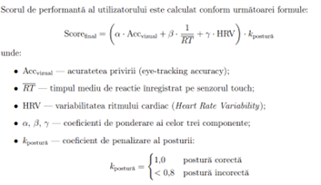
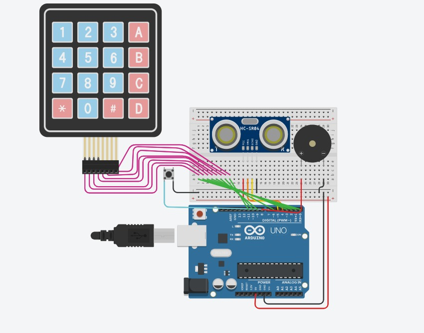
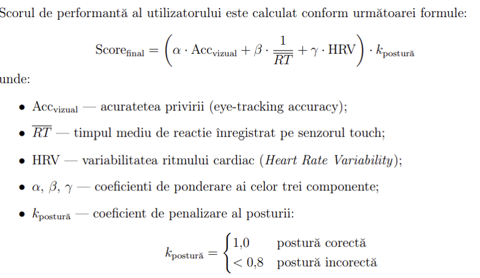

# Fișa de înscriere a proiectului

## 1. Date de identificare

- **Titlul proiectului şi acronimul:** F.O.C.U.S AI
- **Categorie:** Seniori
- **Secțiune:** Tehnologia Informației
- **Mentorul echipei:** prof. Apostol Valeriu, Liceul cu Program Sportiv Galați / Centrul Județean de Excelență Galați, secțiunea Robotică, 0764273636
- **Echipa de proiect:**
  - Condrici Mihai (clasa a X-a, Colegiul Național „Vasile Alecsandri" Galați / Centrul Județean de Excelență Galați, secțiunile C++, C#, Robotică) - realizator al aplicației WPF și modului Hardware
  - Pătrașc Matteo (clasa a X-a, Colegiul Național „Costache Negri" Galați / Centrul Județean de Excelență Galați, secțiunile C++, C#, Robotică) - realizator al modului AI Python
- **Colaboratori/parteneri:**
  - prof. Dinu Elena, Colegiul Național „Costache Negri" Galați / Centrul Județean de Excelență Galați, secțiunile C++, C#
  - prof. Panaite Daniela, Colegiul Național „Costache Negri" Galați, Biologie
  - dr. Sevastian Emanuiela, medic specialist în neurologie pediatrică, Spitalul de Urgență pentru Copii "Sfântul Ioan" Galați
  - Sorana Mocanu, psiholog

## 2. Rezumatul proiectului

> Proiectul F.O.C.U.S. AI propune o stație neuro-cognitivă bimodală de ultimă generație, concepută pentru a măsura, analiza și antrena capacitatea de concentrare umană într-un context digital tot mai fragmentat. În centrul inovației noastre se află tranziția de la evaluările psihologice subiective la o diagnoză bazată pe date biometrice și vizuale colectate în timp real.
>
> Sistemul este construit pe o infrastructură hardware robustă, utilizând un mini PC Lenovo ThinkCenter neo 50q Gen 4 ce rulează Windows 11, echipat cu un sistem dual-monitor portabil YoDoIt de 16.5 inch. Această configurație permite o separare clară a fluxurilor de lucru: un monitor este dedicat pacientului (pentru teste și stimuli vizuali generați software), iar celălalt medicului/specialistului (pentru monitorizarea rezultatelor cognitive, a semnalelor PPG/PRV și a măsurătorilor privirii).
>
> În versiunea software livrată, Arduino Uno gestionează un senzor digital de touch (D2), un buzzer (D3), un senzor ultrasonic opțional (D4/D5), un MAX30102 pentru PPG și un semnal analogic brut de la MyoWare (A0). Semnalul MyoWare nu este tratat drept ECG clinic, iar intervalele de puls MAX30102 sunt etichetate PRV, nu RR provenite din ECG. Autentificarea NFC + PIN pe NumPad rămâne o extensie propusă; modelul cititorului și cablarea nu sunt specificate în sursele hardware ale proiectului.
>
> Datele colectate sunt procesate de un algoritm de fuziune matematică pentru a genera un „Indice de Concentrare" și sunt stocate în Firebase Realtime Database. Aplicația WPF salvează sesiunile în Firebase și include un model de predicție a următoarei sesiuni. O aplicație mobilă Kotlin Multiplatform este menționată ca extensie a ecosistemului, dar sursele ei nu sunt incluse în această arhivă.

## 3. Descriere detaliată a proiectului

### a. Scop

Scopul proiectului F.O.C.U.S. AI este dezvoltarea unei platforme hibride (Hardware-Software) pentru evaluarea experimentală și antrenarea atenției. Implementarea curentă combină estimarea privirii prin cameră, rezultate comportamentale din teste cognitive și măsurători hardware auxiliare (PPG/PRV, semnal analogic MyoWare, touch și distanță ultrasonică atunci când senzorul este conectat). Aceste măsurători sunt indicatori de cercetare/prototip și nu constituie diagnostic medical sau biomarkeri clinici validați.

### b. Obiective

i. **Integrarea unei infrastructuri de calcul performante:** Utilizarea unui mini PC Lenovo ThinkCenter neo 50q Gen 4 și a unui sistem de afișare dual-monitor (YoDoIt 16.5") pentru a separa interfața pacientului de cea a specialistului.

ii. **Dezvoltarea unui modul de monitorizare vizuală:** Implementarea unui algoritm de estimare a privirii în Python folosind OpenCV și MediaPipe Face Mesh. În faza cu punct mobil se calculează proporția eșantioanelor urmărite în zona-țintă; pierderile de tracking sunt păstrate explicit în fișierul de sesiune.

iii. **Construcția modulului hardware de achiziție:** Utilizarea unui Arduino Uno pentru touch, buzzer, MAX30102 PPG, semnalul analogic MyoWare și senzor ultrasonic opțional. MyoWare este salvat ca semnal analogic brut, nu ca ECG validat.

iv. **Extensie planificată – securizarea accesului:** Integrarea unui cititor NFC și a unui NumPad poate fi adăugată după stabilirea modelelor hardware, a pinilor și a protocolului. Această funcționalitate nu este inclusă în firmware-ul curent.

v. **Extinderea ecosistemului în Cloud și Mobile:** Sincronizarea datelor prin Firebase și dezvoltarea unei aplicații mobile cross-platform folosind Kotlin Multiplatform (KMP).

vi. **Modelarea matematică a performanței:** Crearea unui algoritm de predicție a progresului cognitiv bazat pe analiza trendurilor istorice.

### c. Problema identificată și studiul de piață

**Problema identificată:** Mediul digital contemporan, dominat de conținut de tip „short-form" (TikTok, Reels), antrenează creierul pentru recompense rapide și atenție de scurtă durată. Acest fenomen duce la o degradare a concentrării profunde și la creșterea ratelor de ADHD indus digital. Metodele clasice de evaluare (chestionarele) sunt subiective, iar pacienții nu pot identifica momentul exact în care atenția lor colapsează.

**Studiul de piață:** Soluțiile profesionale de eye-tracking (ex. Tobii) sunt extrem de costisitoare (mii de euro) și se concentrează strict pe privire, ignorând starea fiziologică sau postura. Dispozitivele clinice ECG sunt voluminoase și nu sunt integrate în platforme de antrenament cognitiv. F.O.C.U.S. AI ocupă această nișă, oferind o soluție portabilă, accesibilă și integrată, care explorează corelarea privirii cu indicatori PPG/PRV și măsurători auxiliare de distanță; aceste măsurători nu reprezintă, în forma curentă, o evaluare clinică a stresului sau posturii.

### d. Etapele parcurse

i. **Cercetare și Design (Septembrie - Noiembrie 2025):** Studiul impactului stimulilor asupra HRV (Heart Rate Variability) și proiectarea arhitecturii sistemului dual-monitor.

ii. **Dezvoltare AI și Backend (Decembrie 2025 - Ianuarie 2026):** Antrenarea algoritmului de landmark detection și configurarea bazei de date Firebase.

iii. **Prototipare Hardware (Februarie - Martie 2026):** Integrarea senzorului de touch, a buzzer-ului și a modulelor PPG/analogice; NFC rămâne extensie planificată.

iv. **Integrare și UI/UX (Aprilie 2026):** Dezvoltarea interfeței WPF în C# și a logicii de comunicare serială. Componenta mobilă KMP nu este inclusă în această arhivă.

v. **Validare și Calibrare (Mai 2026):** Testarea sistemului pe eșantioane de control și ajustarea algoritmului de predicție a progresului.

### e. Metode folosite, descrierea sistemului realizat și organizarea studiilor

Sistemul este fundamentat pe o arhitectură *Edge-to-Cloud* compusă din:

#### i. Dezvoltare monitorizare vizuală (AI Python)

Modulul de AI funcționează ca un „ochi digital" care analizează comportamentul utilizatorului fără a necesita senzori invazivi.

- **Tehnologie:** Modulul folosește OpenCV, NumPy și MediaPipe Face Mesh pentru estimarea direcției privirii și intersecția acesteia cu monitorul calibrat.
- **Funcționalitate:** Sesiunea salvează eșantioane temporizate, inclusiv perioadele în care fața/privirea nu este detectată. În faza 2 este urmărit punctul portocaliu, iar fixarea este aproximată printr-o zonă de interes (AOI). Pipeline-ul curent nu măsoară diametrul pupilei și nu calculează blink rate.

#### ii. Dezvoltare Hardware (Arduino UNO R3)

Nucleul fizic este bazat pe **Arduino Uno**, ales pentru stabilitatea sa în aplicații de timp real.

- **Stimuli și Reacție:** Stimulii vizuali sunt generați software pe monitorul YoDoIt, iar cei auditivi prin **buzzer**. Reacția este captată instantaneu de un **senzor de touch**, eliminând erorile mecanice.
- **Măsurare auxiliară a distanței:** Senzorul ultrasonic (dacă este montat) transmite distanța în centimetri. În versiunea curentă aceasta este salvată ca măsurătoare auxiliară; nu este folosită pentru a deduce stresul/postura și nu invalidează automat sesiunea.
- **Biometrie:** MAX30102 captează PPG și intervale dintre pulsuri (PRV). MyoWare este colectat separat ca semnal analogic brut pe A0; acesta nu este interpretat sau prezentat ca ECG clinic.
- **Extensii hardware neincluse:** NFC și NumPad nu sunt implementate în firmware-ul livrat, deoarece arhiva-sursă nu identifică modulele, interfața electrică sau protocolul necesar. Acestea nu trebuie considerate funcționalități existente.

#### iii. Dezvoltare UI/UX Desktop (WPF, C#)

Aplicația principală este dezvoltată în **WPF (C#)**, rulând pe **Lenovo ThinkCenter neo 50q**.

- **Dual-Monitor Workflow:**
  - *Monitorul 1 (Pacient):* Afișează o interfață curată, unde apar testele cognitive și jocurile.
  - *Monitorul 2 (Doctor):* Afișează dashboard-ul de control, graficele biometrice LiveCharts și feed-ul video cu datele de eye-tracking suprapuse.
- **Arhitectură:** Implementăm pattern-ul MVVM pentru o separare clară a logicii de prezentare, facilitând scalabilitatea proiectului.

#### iv. Dezvoltare aplicație mobilă

- Arhiva curentă conține aplicația desktop WPF și integrarea Firebase.
- O aplicație Kotlin Multiplatform (Android/iOS) poate fi livrată separat, dar codul ei nu se află în această arhivă și nu este inclusă în verificarea implementării de aici.

#### v. Analiza Matematică a Concentrării

Se folosește o funcție compusă:



### f. Date experimentale

Validarea preliminară, efectuată pe un eșantion de control, confirmă stabilitatea și precizia arhitecturii hibride F.O.C.U.S.:

- **Validare vizuală:** Trackerul exportă eșantioane cu timestamp, validitatea privirii și zona-țintă. FPS-ul, acuratețea și calibrarea trebuie raportate doar după măsurători reproductibile pe configurația camerei și a monitorului folosit; arhiva nu conține un studiu care să valideze o rată de clasificare de 85–90%.
- **Achiziție hardware:** Firmware-ul transmite cadre seriale la o perioadă nominală de 10 ms și măsurători ultrasonice actualizate la aproximativ 250 ms. Latența reală trebuie măsurată pe placa și cablajul folosite.
- **Sincronizare și Cloud (WPF & Firebase):** Datele sunt serializate în Firebase împreună cu sursa semnalului. PRV derivat din PPG și MyoWare analogic nu sunt etichetate ca ECG. Latența de scriere și fiabilitatea trebuie măsurate în rețeaua de utilizare; nu sunt declarate aici valori nevalidate.

### g. Concluzie

Proiectul **F.O.C.U.S. AI** reprezintă o soluție tehnologică matură și inovatoare pentru o problemă critică a societății moderne. Prin integrarea armonioasă a inteligenței artificiale, a microelectronicii (Arduino Uno) și a dezvoltării multiplatformă (KMP), am reușit să creăm un sistem care nu doar măsoară atenția, ci oferă o cale clară spre îmbunătățirea acesteia. Dualitatea hardware-software și precizia biometrică fac din acest proiect un instrument de referință în educația și psihologia digitală a anului 2026.

### h. Bibliografie

i. Holmqvist, K., Nyström, M., Andersson, R., Dewhurst, R., Jarodzka, H., & Van de Weijer, J. (2011). Eye tracking: A comprehensive guide to methods and measures. Oxford University Press.

ii. Posner MI, Petersen SE. The attention system of the human brain. Annu Rev Neurosci. 1990;13:25-42. doi: 10.1146/annurev.ne.13.030190.000325. PMID: 2183676.

iii. Bradski, G. (2000) The OpenCV Library. Dr. Dobb's Journal of Software Tools, 120; 122-125.

iv. King, D. (2009) Dlib-ml: A Machine Learning Toolkit. Journal of Machine Learning Research, 10, 1755-1758.

v. Arduino UNO R3 Documentation [https://docs.arduino.cc/hardware/uno-rev3/](https://docs.arduino.cc/hardware/uno-rev3/)

vi. Firebase Documentation [https://firebase.google.com/docs](https://firebase.google.com/docs)

vii. .NET Windows Presentation Foundation (WPF) Documentation [https://learn.microsoft.com/en-us/dotnet/desktop/wpf/](https://learn.microsoft.com/en-us/dotnet/desktop/wpf/)

### i. Anexe

#### i. Schema grafică a modulului hardware



#### ii. Randarea CAD-ului machetei



#### iii. Codul pentru Arduino UNO

Codul de firmware complet este păstrat în folderul `cod_arduino/` (`cod_arduino.ino`, `spo2_algorithm.cpp`, `spo2_algorithm.h`). Protocolul serial este versiunea 2 și include handshake-ul `PING,FOCUS_AI` / `PONG,FOCUS_AI,2`, evenimente temporizate pentru touch/buzzer, cadre de date și intervale PPG-PRV. Instrucțiunile de cablare, instalare și încărcare sunt în [HARDWARE_INTEGRATION.md](HARDWARE_INTEGRATION.md). Nu utilizați fragmentul MAX30100 din versiunile vechi ale documentației: nu mai corespunde firmware-ului livrat.


#### iv. Secvențe din Codul pentru modulul AI cu Python

```python
# ── SCOR & ÎNREGISTRARE ──────────────────────────────────────────────────────

def intersect_gaze_with_tuned_monitor(O, D):
    """Intersectează raza privirii cu planul monitorului calibrat.
    Returnează coordonate normalizate (mx, my) în [0,1] sau None."""
    origin = np.asarray(corner_world_pts[0], dtype=float)
    u = np.asarray(corner_world_pts[1], dtype=float) - origin
    v = np.asarray(corner_world_pts[3], dtype=float) - origin
    N = np.cross(u, v); N /= np.linalg.norm(N)
    t = float(np.dot(N, origin - O) / np.dot(N, D))
    if t <= 0: return None
    P = O + t * D
    return get_monitor_coords_tuned(P) # -> (mx, my)


def start_recording():
    """Porneste sesiunea de 60s: 30s imagine statica + 30s puncte in miscare."""
    recording_active = True
    recording_start_t = time.time()
    recorded_coords = []
    show_stimulus_window()


def stop_recording_and_save():
    """Opreste sesiunea, salveaza coordonatele si le trimite aplicatiei C#."""
    recording_active = False
    hide_stimulus_window()
    save_results() # -> gaze_coords.txt
    send_coords_to_csharp(recorded_coords)


# ── CALIBRARE OCULARA ────────────────────────────────────────────────────────

def advance_calib_point_stage1(O, D):
    """Înregistreaza un punct de calibrare: intersecteaza privirea cu planul
    monitorului si stocheaza colturile pentru calibrarea fina."""
    hit = get_gaze_hit_point(O, D)
    screen_calib_points_world.append(hit)
    if current_calib_index in _CORNER_CALIB_INDICES:
        corner_world_pts.append(hit.copy()) # 4 colturi -> monitor_tuned = True
    if current_calib_index >= N_CALIB_POINTS:
        _finish_calibration() # -> start_recording() automat


# ── PLAN MONITOR (geometrie 3D) ──────────────────────────────────────────────

def create_monitor_plane(head_center, R_final, face_landmarks, ...):
    """Construieste un plan virtual al monitorului in spatiul capului.
    Returneaza: corners[4], center_w, normal_w, units_per_cm."""
    head_forward = -R_final[:, 2]
    center_w = head_center + head_forward * (50.0 * upc)
    # dreapta/sus din orientarea capului -> dreptunghi 60x40 cm-echivalent
    return [p0, p1, p2, p3], center_w, normal_w, upc


# ── DIRECTIA PRIVIRII COMBINATE ──────────────────────────────────────────────

# Per frame, dupa detectia MediaPipe:
lgd = iris_3d_left - sphere_world_l; lgd /= np.linalg.norm(lgd)
rgd = iris_3d_right - sphere_world_r; rgd /= np.linalg.norm(rgd)
rc = (lgd + rgd) / 2; rc /= np.linalg.norm(rc)
combined_gaze_directions.append(rc) # deque(maxlen=10) -> filtru temporal
avg_combined_direction = np.mean(combined_gaze_directions, axis=0)
```